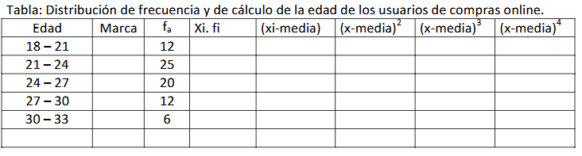

Ejercicio Nº 22: De la construcción de intervalos de clases obtenidos de abajo se pide:
a) Obtenga las medidas de tendencia central e interprételas.
b) Calcule los cuartiles 1 y 3 interprételos.
c) Calculo el percentil 10, 65 y 90 e interprételos.
d) Construya un diagrama de caja
e) Calcule las medidas de variabilidad (Rango, desvío estándar, rango intercuatilico y CV)
f) Calcular medidas de asimetría

